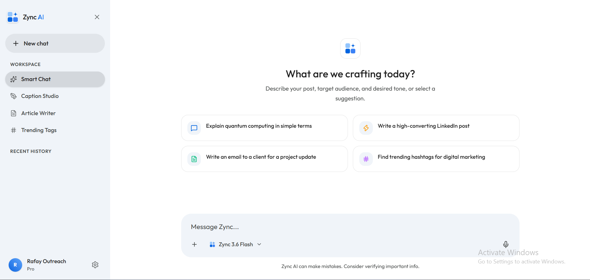

# Zync AI - Enterprise All-In-One AI Platform & PWA

Zync AI is a high-performance, enterprise-grade AI web application and Progressive Web App (PWA) designed to provide uninterrupted access to multi-modal AI capabilities. Built with a resilient multi-provider fallback architecture, Zync AI combines intelligent conversational interfaces, content generation suites, and automated technical SEO tools into a single, cohesive SaaS platform.

## Key Features

### Smart Chat Interface
- Multi-model conversational streaming with full Markdown rendering and dynamic syntax highlighting.
- Session persistence and context-aware thread management.
- Real-time token optimization for fast response latency.

### Caption Studio
- Dynamic copy generation tailored for multi-platform content strategy (LinkedIn, X/Twitter, Instagram).
- Custom tone, intent, and audience segmentation controls.
- Integrated hashtag generation and call-to-action optimization.

### SEO Article Studio Pro
- Comprehensive long-form article generation with automated structured outlines.
- Intelligent context-aware internal and external link insertion.
- Complete metadata suite generation (SEO titles, meta descriptions, canonical slugs, open graph tags).
- Granular section regeneration enabling targeted editing without disrupting full document structure.

### Progressive Web App (PWA)
- Full installability on desktop and mobile operating systems.
- Offline support and responsive caching strategies via service workers.
- Native application-like experience across viewport sizes.

### Resilient API Fallback Engine
- Multi-provider load balancing and automatic failover system across Gemini, Groq, and Cohere.
- Zero-downtime execution ensures request fulfillment even during individual provider outages.
- Smart rate-limit handling and automated retry logic.

---

## Tech Stack

### Frontend
- **Framework:** React 18 with Vite
- **Styling:** Tailwind CSS
- **Markdown & Code:** React Markdown, Syntax Highlighting
- **Icons:** Lucide React
- **PWA Integration:** Vite PWA Plugin, Service Workers

### Backend
- **Runtime Environment:** Node.js
- **Web Framework:** Express.js
- **Database & ODM:** MongoDB, Mongoose
- **API Orchestration:** Custom Fallback Router (Axios/SDK integration)

---

## Architecture & API Fallback Mechanism

Zync AI implements a fault-tolerant provider routing architecture designed to eliminate single-point-of-failure vulnerabilities common in single-provider AI wrappers.

              +-----------------------+
              |     Client Request    |
              +-----------+-----------+
                          |
                          v
              +-----------------------+
              |   Express API Router  |
              +-----------+-----------+
                          |
                          v
              +-----------------------+
              | Resilient Router Node |
              +-----------+-----------+
                          |
  +-----------------------+-----------------------+
  | (Primary)             | (Fallback 1)          | (Fallback 2)
  v                       v                       v
+-----------+           +-----------+           +-----------+
| Groq API  | --(Fail)->| Gemini API| --(Fail)->| Cohere API|
| (Llama 3) |           |           |           |           |
+-----------+           +-----------+           +-----------+
|                       |                       |
+-----------------------+-----------------------+
|
v
+-----------------------+
| Standardized Response |
+-----------------------+

### Execution Flow
1. **Primary Route:** The system dispatches requests to the high-speed primary provider (Groq / Llama 3).
2. **Health Detection:** If a rate-limit (HTTP 429), server error (HTTP 5xx), or timeout occurs, the middleware catches the exception without returning an error to the client.
3. **Automated Failover:** The router sequentially routes the payload to secondary providers (Gemini, then Cohere) using normalized request schemas.
4. **Data Normalization:** Responses are standardized into a unified output structure before being streamed to the frontend interface.

---

## SaaS Acquisition & Commercial Sale

This complete, production-ready SaaS codebase and intellectual property for **Zync AI** are available for direct commercial acquisition.

### What Is Included in the Sale:
- **Complete Source Code:** Full rights to both frontend and backend repositories.
- **Production Architecture:** Complete multi-provider API router logic and MongoDB database schemas.
- **PWA Configuration:** Production-ready PWA assets and caching strategy scripts.
- **Handover & Support:** Assistance with server deployment, environment variable configuration, infrastructure setup, and domain transfer.

For pricing inquiries, acquisition terms, or a live application walkthrough, please contact directly:

**Contact for Inquiries:** `mrafaykh@outlook.com`  
**Subject Line:** `Zync AI - Commercial Acquisition Inquiry`

---

## Author & Developer

Engineered and developed by **Rafay**.
- Full-Stack Developer & Technical SEO Specialist.

---

## License & Ownership

This codebase is proprietary intellectual property. Unauthorized copying, public redistribution, or deployment of this software without explicit purchase or license agreement is strictly prohibited.
